# Beezy — Study App

Date: 2026-11-24

[Canvas project](https://ciit.instructure.com/courses/26695/quizzes/11648)

An Android flashcard study app in Kotlin with local SQLite storage: build decks, review cards with spaced repetition, take quizzes, and time study sessions.

---

## Features

1. **Local Accounts**: Sign up or log in; each account has its own decks and progress (seed account: `demo` / `password123`).
2. **Decks**: Create, edit, and delete decks with a title, description, and tags; search by name or tag, filter by tag, and sort by date, title, or card count.
3. **Cards**: Add, edit, and delete flashcards in a deck; star decks and reset their progress.
4. **Spaced Repetition**: Flip a card and rate it Again, Hard, Good, or Easy; SM-2 updates its interval, ease factor, and due date.
5. **Quizzes**: Generate a multiple-choice quiz from a deck and review the result.
6. **Pomodoro Timer**: Run focus and break sessions in a foreground service with notifications; set focus, short-break, and long-break lengths in the timer settings.
7. **Profile & Settings**: Edit display name and avatar, switch light/dark theme (saved with DataStore), and reset local data.
8. **Sample Data**: Each new account starts with two tutorial decks.
9. **Account Deletion**: Delete the signed-in account together with its decks and review history.

---

## Security

- Sign-in is required before the deck list is shown; there is no guest mode.
- Passwords are masked while typing; the eye button reveals them on demand.
- Passwords are hashed with PBKDF2-HMAC-SHA256 (120,000 iterations, per-user salt). Older SHA-256 hashes are upgraded on the next successful login.
- A wrong username and a wrong password return the same message, so the screen does not confirm whether an account exists.
- Usernames, emails, and passwords are validated for format before an account is created.
- Decks belong to the account that created them, and every list, reset, and delete is scoped to the signed-in user.
- All SQL is a constant statement with bound arguments.
- The app requests only the notification and foreground-service permissions the Pomodoro timer uses.
- Android backups are disabled, so the local database does not leave the device through backup.
- No API keys, secrets, or sensitive logging.

---

## Project Structure

```
├── build.gradle.kts                   # plugins via version catalog
├── settings.gradle.kts
├── gradle/
│   ├── libs.versions.toml             # dependency versions
│   ├── gradle-daemon-jvm.properties
│   └── wrapper/
├── gradlew / gradlew.bat
├── TESTING.md                         # functional and security test results
├── database/
│   ├── schema.sql                     # schema version 3, no data
│   └── beezy.db                       # seed snapshot (demo account, two decks)
├── app/
│   ├── build.gradle.kts               # Compose, compileSdk 37, minSdk 26
│   ├── proguard-rules.pro
│   └── src
│       ├── main/
│       │   ├── AndroidManifest.xml
│       │   ├── java/com/beezy/app
│       │   │   ├── MainActivity.kt
│       │   │   ├── BeezyApplication.kt
│       │   │   ├── data/local/        # SQLiteOpenHelper, DAOs, entities, seed
│       │   │   ├── data/local/security/   # PBKDF2 password hashing
│       │   │   ├── data/local/datastore/  # preferences, theme mode
│       │   │   ├── data/repository/   # repository implementations
│       │   │   ├── domain/            # models, repository interfaces, use cases
│       │   │   ├── di/                # AppContainer, dispatchers
│       │   │   └── presentation/      # Compose screens, components, navigation, theme
│       │   └── res/                   # drawables, mipmaps, values
│       └── test/java/com/beezy/app    # JUnit tests for use cases and hashing
└── screenshots/                       # captured from the emulator
```

---

## Database

The app stores everything in `beezy.db`, a local SQLite database created by
`BeezyDatabase` (`SQLiteOpenHelper`, schema version 3). On the device it lives at
`/data/data/com.beezy.app/databases/beezy.db`.

| Table | Purpose | Key columns |
|-------|---------|-------------|
| `decks` | flashcard decks | `id`, `userId` (owner), `title`, `description`, `tags`, `builtIn`, `starred`, `createdAt` |
| `cards` | questions and SM-2 state | `id`, `deckId` (foreign key, cascade delete), `question`, `answer`, `tag`, `reps`, `interval`, `easeFactor`, `dueDate`, `lastReviewed` |
| `users` | local accounts | `id`, `username`, `email`, `passwordHash`, `displayName`, `avatarIndex`, `createdAt` |

`username` and `email` are unique. Deleting a deck deletes its cards. Theme and
Pomodoro preferences live in DataStore (`beezy_preferences`), not in SQLite.

The same schema ships with the project:

- [`database/schema.sql`](database/schema.sql) recreates all tables and indexes on
  an empty database: `sqlite3 fresh.db < database/schema.sql`.
- [`database/beezy.db`](database/beezy.db) is a snapshot taken right after first
  launch. It contains only the seed data: the `demo` account (PBKDF2 hash, no
  plaintext) and its two tutorial decks. Open it with any SQLite viewer.

---

## How to Run

### Command Line

```bash
# Windows
.\gradlew.bat test
.\gradlew.bat assembleDebug

# Linux / macOS
./gradlew test
./gradlew assembleDebug
```

The debug APK is written to `app/build/outputs/apk/debug/app-debug.apk`.

### Release APK

```bash
./gradlew assembleRelease
```

The signed APK is written to `app/build/outputs/apk/release/app-release.apk` when
`keystore.properties` exists in the project root (it points at a local keystore
and is not committed). Without it, the release build falls back to debug signing
so the command still works.

### In Android Studio

1. Open the `Final Project` folder and let Gradle sync.
2. Pick an emulator or device (API 26 or higher) and press **Run**.
3. Run the tests from **Build > Run Unit Tests** or the `test` run configuration.

Sign in with `demo` / `password123`, or create an account.

---

## Screenshots

| Sign in | Deck list |
|---------|-----------|
| 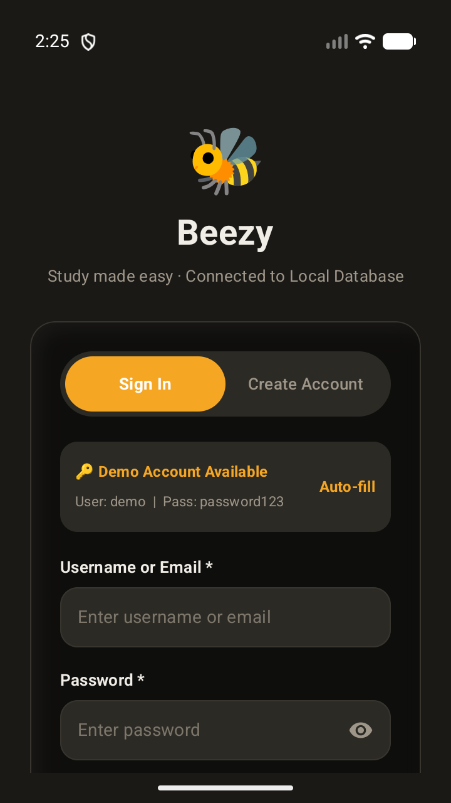 | 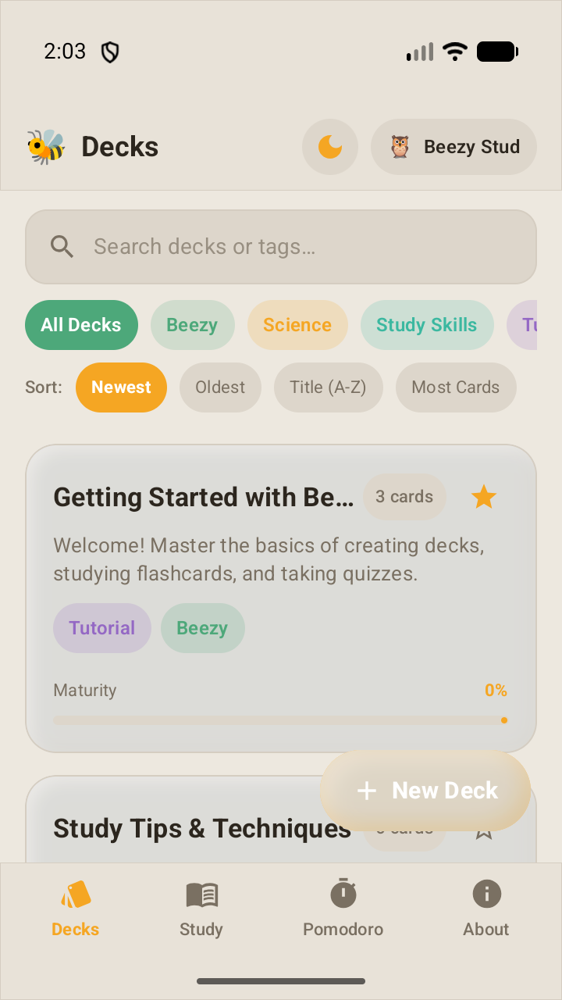 |

| Deck detail | Flashcard front |
|-------------|-----------------|
| 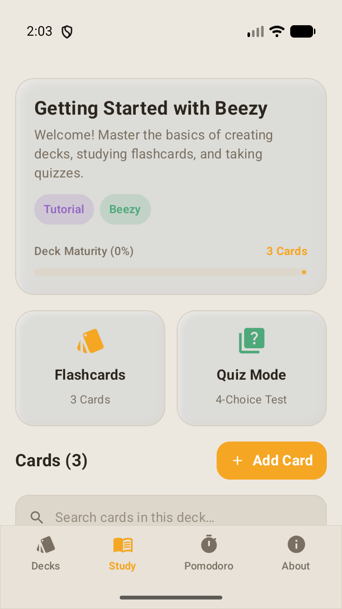 | 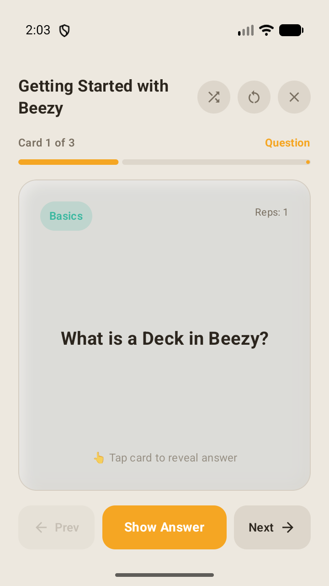 |

| Flashcard answer | Quiz |
|------------------|------|
| 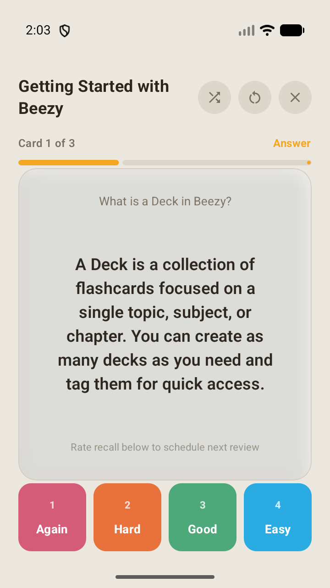 | 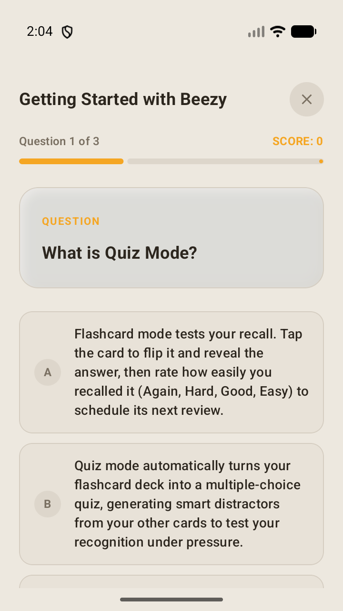 |

| Quiz answer | Pomodoro timer |
|-------------|----------------|
| 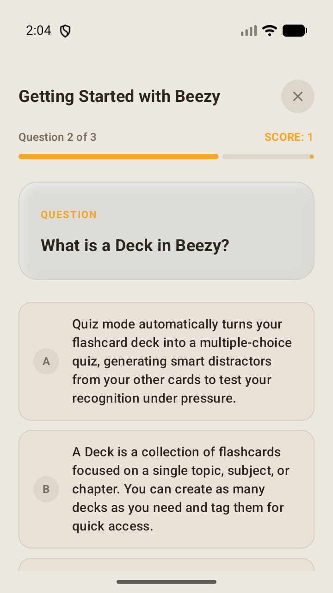 | 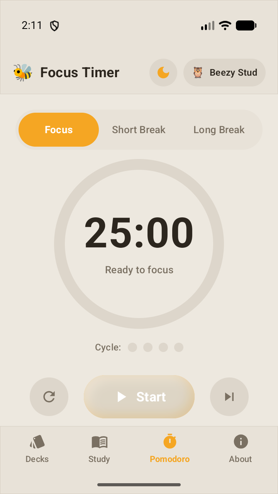 |

| About | Dark theme |
|-------|------------|
| 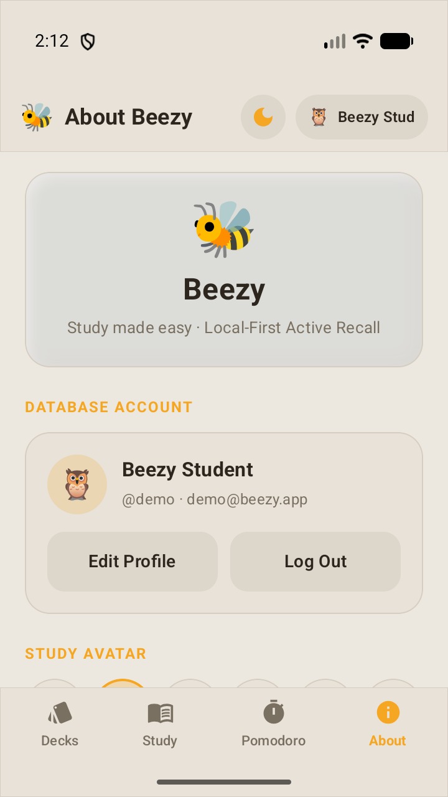 | 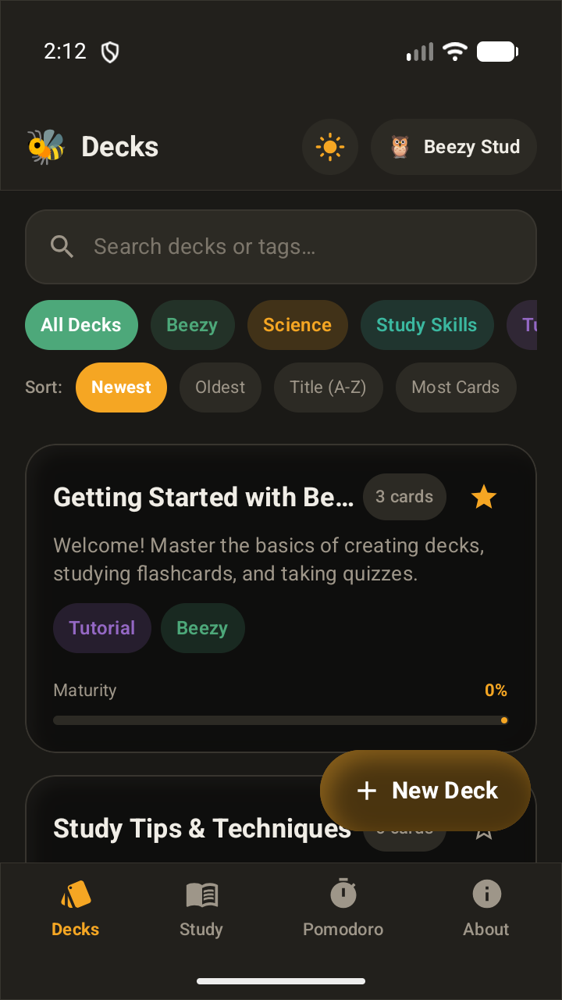 |

| Delete confirmation | About, dark |
|---------------------|-------------|
| 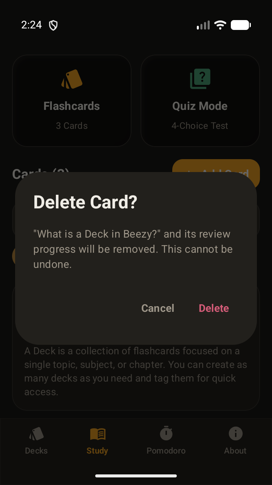 | 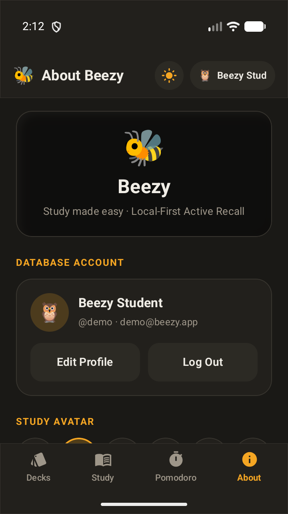 |

| Masked password | Edit deck |
|-----------------|-----------|
| 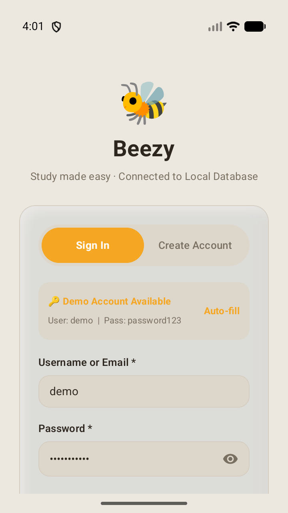 | 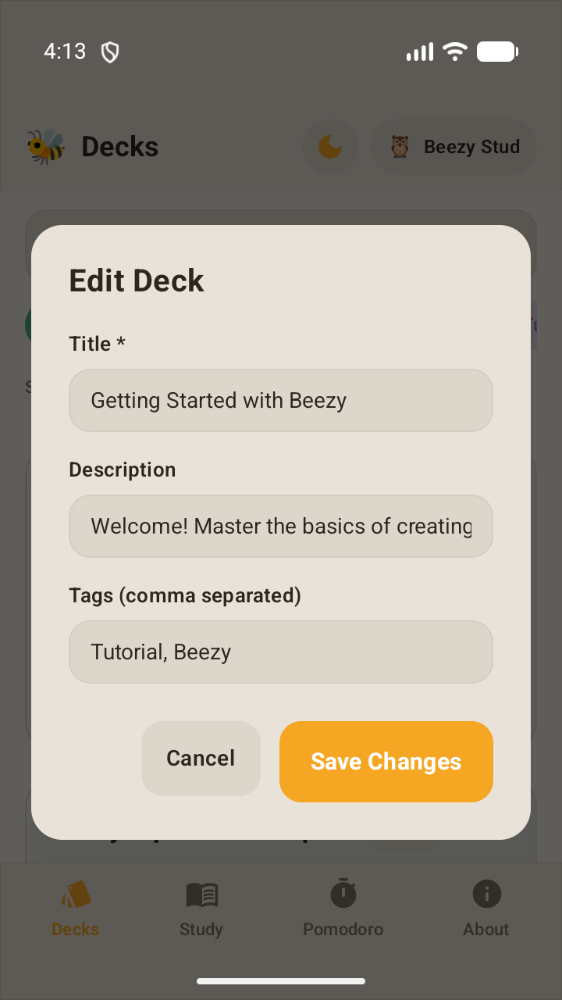 |

| Timer settings | Write error |
|----------------|-------------|
| 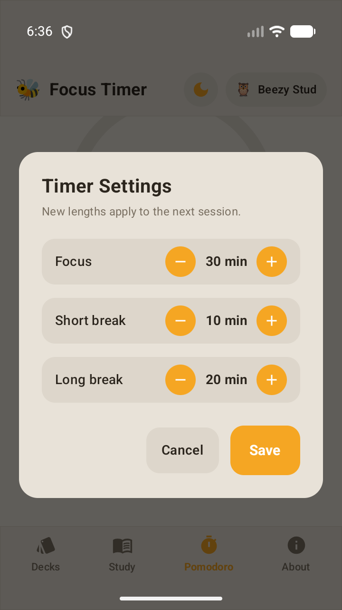 | 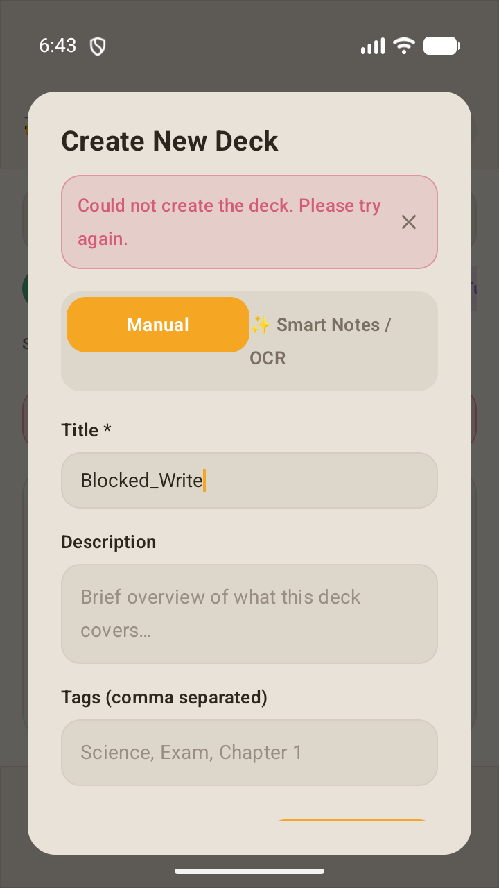 |
